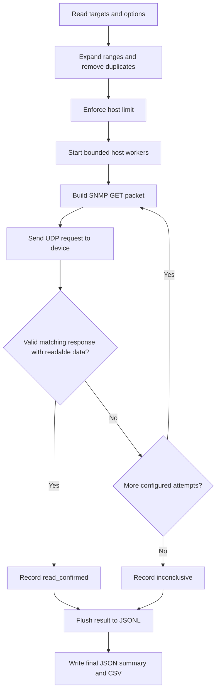

# SNMP LAN Checker: What We Are Building and How It Works

## Project purpose

We are building a command-line tool that checks devices on a LAN for SNMP read access using the community string `public`, or other communities explicitly supplied by the operator. It helps identify devices that expose basic management information to the machine running the checker.

The tool is written entirely in Python using the standard library. It sends SNMP packets directly, without `snmpwalk`, Nmap, shell commands, or third-party packages.

Repository: [Sivaprasad-MP/snmp-lan-checker](https://github.com/Sivaprasad-MP/snmp-lan-checker).

## What changed from the original tool

The original script launched external commands, tried a built-in community dictionary, walked many device tables, and attempted a full information dump. The current implementation focuses on a small, read-only check with validated responses and bounded concurrency.

It also adds target deduplication, a configurable host limit, explicit SNMP version selection, reliable CSV escaping, and incremental result files. The original script remains in the local folder as `snmp_strings.py.bak`; that backup is excluded from Git.

## What a community string means

For SNMPv1 and SNMPv2c, a community string is a shared value sent in the request. The device decides whether to accept the request based on its configuration, which can also restrict the source address and readable objects.

This tool tests the values you supply. It does not retrieve an unknown community from a device or automatically guess a dictionary. With no options, it checks only `public`. A confirmed response establishes read access to the returned objects; it does not establish write access or access to every SNMP object.

## Scan flow



1. Parse IP addresses, CIDR subnets, full address ranges, or IPv4 shorthand ranges.
2. Expand them into individual addresses, remove duplicates, and enforce the host limit before sending traffic.
3. Start up to the configured number of host workers. Each worker checks its communities and versions sequentially.
4. Encode a read-only GET request using ASN.1 Basic Encoding Rules (BER). Include the SNMP version, community, random request ID, and three requested objects.
5. Send the packet through a connected UDP socket to port 161 by default. Connecting a UDP socket selects the peer; it is not a connection handshake or proof that the port is open.
6. Wait for a response within the configured timeout. Ignore malformed or unmatched replies while time remains. Retry only if requested.
7. Validate and decode the reply. Stop checking that host after its first confirmed read response.
8. Save each completed host immediately to JSONL. Write the summary JSON and confirmed-host CSV when the scan ends.

## Information requested

A single request contains these three object identifiers (OIDs):

| Object | OID | Expected type | Report field |
| --- | --- | --- | --- |
| System description | `1.3.6.1.2.1.1.1.0` | Octet string | `description` |
| System name | `1.3.6.1.2.1.1.5.0` | Octet string | `name` |
| System uptime | `1.3.6.1.2.1.1.3.0` | TimeTicks | `uptime`, converted to seconds |

The tool performs no SET operations, table walks, or full device dumps.

## How a response is validated

The checker requires a complete BER message, the expected SNMP version and community, a Response PDU, a matching request ID, and a zero SNMP error status. It then looks for a requested OID with the expected value type. At least one such value must be present to confirm access.

Missing-object exceptions, unexpected value types, malformed messages, mismatched request IDs, and SNMP error responses do not count as confirmed read access. The connected UDP socket filters incoming datagrams to the selected peer; this is not cryptographic authentication.

## Defaults and options

| Setting | Default | Option |
| --- | --- | --- |
| Community | `public` | `--community VALUE`, repeatable |
| SNMP version | `2c` | `--version 1`, `2c`, or `both` |
| Concurrent hosts | 10 | Second positional argument, 1–64 |
| Timeout per attempt | 2 seconds | `--timeout`, 0.1–30 |
| Retries after initial attempt | 0 | `--retries`, 0–3 |
| UDP destination port | 161 | `--port` |
| Maximum unique hosts | 4096 | `--max-hosts` |
| Report directory | Timestamped `snmp_range_...` directory | `--output` |

With `--version both`, each community is checked with v2c and then v1. The first confirmed response ends checks for that host, so the report does not inventory every working community or version.

## Running the tool

Run these commands from the project folder. Replace example targets with your authorized LAN addresses.

```bash
# Check a /24 LAN: 254 host addresses, 16 concurrent hosts.
python3 snmp_strings.py 192.168.1.0/24 16

# Try SNMPv2c and SNMPv1.
python3 snmp_strings.py 192.168.1.0/24 16 --version both

# Check two LANs and choose the report directory.
python3 snmp_strings.py 192.168.1.0/24,192.168.2.0/24 16 --output reports

# Check explicitly supplied communities.
python3 snmp_strings.py 192.168.1.0/24 --community public --community your-known-community

# Show all options.
python3 snmp_strings.py --help
```

IPv4 network and broadcast addresses are excluded for prefixes shorter than /31. There is no ping prerequisite, so a device does not need to answer ICMP to receive an SNMP check. Large IPv6 ranges normally exceed the host limit; individual IPv6 addresses and sufficiently small ranges are supported.

## Understanding results

| Status | Meaning |
| --- | --- |
| `read_confirmed` | A valid response returned at least one requested object with its expected type. |
| `inconclusive` | No attempt confirmed access. Possible causes include filtering, timeout, unsupported SNMP configuration, restricted objects, or an incorrect community. |
| `error` | A worker encountered an unexpected exception; its message is recorded. |

An inconclusive result does not prove a device is secure, offline, or has UDP 161 closed. SNMPv3 is not implemented. SNMPv1 can reject a multi-object request if one requested object is unavailable; the tool does not fall back to separate requests for each object.

## Report files

- `results.jsonl`: one JSON object per completed host, flushed immediately so completed results survive an interruption.
- `results.json`: scan time, supplied targets, target count, completed count, interruption flag, confirmed count, and collected host results.
- `accessible.csv`: confirmed hosts with IP, community, version, system name, description, and uptime in seconds.

Reports include working community strings and device information. They are written locally. Default scan folders, the `reports` folder, Python cache files, and backup files are ignored by Git.

Ctrl+C stops scheduling work and preserves results already collected. The program waits for active workers to finish their bounded attempts before writing final summaries; those workers may finish after result collection has stopped.

Exit codes are `0` for no confirmed access, `1` for at least one confirmed host, `2` for invalid arguments, and `130` for interruption. Exit code 1 is therefore a finding, not necessarily a program failure.

## Code map

| Functions | Responsibility |
| --- | --- |
| `tlv`, `integer`, `base128`, `encode_oid` | Encode BER fields and OIDs. |
| `read_tlv`, `children`, `decode_oid` | Decode BER fields and OIDs with length checks. |
| `request` | Build the three-object SNMP GET. |
| `parse_response` | Validate the reply and extract readable values. |
| `query` | Send and receive UDP packets with timeouts and retries. |
| `scan_host` | Try the configured communities and versions for one host. |
| `targets` | Expand ranges, deduplicate addresses, and enforce limits. |
| `main` | Parse options, manage workers, print progress, and write reports. |

## Testing and current verification

```bash
python3 -m unittest -v test_snmp_strings.py
```

The test suite covers BER encoding, response validation, missing-object exceptions, request matching, target expansion, mocked packet exchange, retries, and timeouts. It also includes two local UDP tests using a simulated agent.

In the development environment, four tests passed and two live UDP tests were skipped because socket creation was prohibited. Additional mocked command-line checks passed for report generation, CSV quoting, deduplication, exit codes, and invalid input rejection. Those additional checks were run separately and are not currently saved in the test suite.

Actual communication with a physical SNMP device has not yet been verified. The next validation step is to run the tool against a known SNMP-enabled device on an authorized LAN and compare the expected community, name, and uptime with the generated report.
